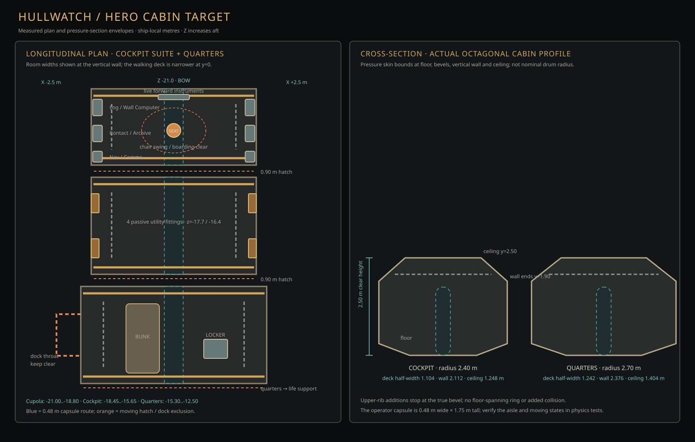

# Hero cabin art target

## Direction

Build the cockpit suite and quarters as cramped, serviceable pressure cabins assembled around a visible load path. The local references show a strong sequence of deep transverse rings, dark recesses between them, angular equipment mounted on the cabin wall, and warm work lights cutting across cool dark machinery. The cockpit still needs to read as a practical work station: the existing pilot chair stays centered, the six working CRT stations stay on their side walls, the three live forward instruments remain in reach, and the floor route stays legible.

Use the ring rhythm and layered construction in [Reference/ref1.png](../../../Reference/ref1.png) and [Reference/cockpit.png](../../../Reference/cockpit.png) as composition cues. [Reference/ref2.png](../../../Reference/ref2.png) is a close-up cue for bulky, physical retro terminals. The unfinished local captures are [cockpit](review/shot_hero_cockpit.png), [utility wall](review/shot_hero_utility.png), and [quarters](review/shot_hero_quarters.png); they document the starting point, not the acceptance target. The [official Starpath listing](https://store.steampowered.com/app/1779540/Starpath/) describes its retro aesthetic as mostly 1970s/1980s inspired. Use the user's pictures for visual decisions; do not copy Starpath's exact ship, branding, or assets.

## Measured space

Coordinates are in metres in `ShipGeometry` local space. Z increases aft. Section spans exclude the 0.35 m bulkhead gap after each section. The usable cabin profile comes from `SectionHull.tube_section()` and `SectionHull.tube_half_width()`; the section radius is not the wall reach.

| Section | Z span | Length | Radius | Half-width at deck (y=0) | Wall (y=0.3–1.9) | Ceiling (y=2.5) |
|---|---:|---:|---:|---:|---:|---:|
| Cupola | -21.00 to -18.80 | 2.20 | 2.40 | 1.104 | 2.112 | 1.248 |
| Cockpit drum | -18.45 to -15.65 | 2.80 | 2.40 | 1.104 | 2.112 | 1.248 |
| Quarters | -15.30 to -12.50 | 2.80 | 2.70 | 1.242 | 2.376 | 1.404 |

The cabin is 2.50 m high. The lower bevel widens from the deck to the vertical wall over y=0.0–0.3 m; the upper bevel narrows from the wall to the ceiling over y=1.9–2.5 m. At y=2.18 m the half-width is 1.709 m in the cockpit and 1.922 m in quarters. Measure every trim corner against this profile, including its bevels.

## Existing functional layout to preserve

| Element | Ship-local placement and occupied space | Constraint |
|---|---|---|
| Six cockpit CRT stations | y=1.25, x=±1.95; z=-20.65, -19.90, -19.15. Log, Contact, Nav on +X; Wall Computer, Archive, Comms on -X. | Preserve each node name, live program, screen, and interaction. Their fitted collision depth is about 0.316 m; console backs nearly meet the wall. Do not add a second fake display or block their view. |
| Forward instrument row | SwitchBank, GaugeCluster, SevenSegment at z=-20.82, x=-0.62/0/+0.62, y=0.95. | Preserve simulator links and interaction. Keep the chair's forward seated sightline to the instruments/window. |
| Pilot chair | Root (0,0,-19.80), yaw 180°. Seat anchor about (0,0,-20.30); exit anchor about (-0.95,0,-19.22). Chair rotates through 180° and has a 1.8 m boarding radius. | Keep base/back and deployed seat collision; preserve the swing, approach, seated camera, and exit path. No dressing in the capsule or the seat's sweep. |
| Hatches | Cockpit suite at z=-18.625 and -15.475; quarters/life-support joint at z=-12.325. Clear opening 0.90 m wide × 1.85 m high. | Keep threshold clear. Closed leaf has collision; leaf and slab move upward 2.1 m to open. Surround trim may not overlap the moving panel. |
| Cockpit utility fittings | Four inward-facing `hw_utility_spine` models at y=1.4, x=±2.015, z=-17.7/-16.4. Existing interface: backplane origin; x ±0.25, y ±0.55, z 0..0.16; glTF +Y up, +Z front. | Preserve the bounds and mount points through Step 04. Leave wall consoles elsewhere. Keep the fitting passive and clear of the walk lane. |
| Quarters dock | West wall port at z=-13.9. Keep the throat clear over x=-2.376..-3.0, y=0..1.9, z=-14.5..-13.3. | Preserve shell/throat collision, mount plate state, EVA build access, and the opening when a pod is installed. |
| Quarters bunk and locker | Bunk at (-0.8,0.35,-13.8), collision 0.85×0.70×2.0 m. Locker at (0.962,0,-13.5), collision 0.545×1.9×0.611 m (rotated). | Preserve bunk use/save behavior and the existing passage to both hatches and the dock. Check mesh bounds, not only collision-box centres. |
| Wall computer | Screen 0.44×0.38 m; focus camera 0.45 m from screen. Stowed collision 0.16×0.74×0.64 m; deployed collision projects 0.45×0.50×0.60 m into cabin. | Keep the blade's travel and focus-camera view clear. Test stowed and deployed poses. |

The operator capsule is 0.48 m diameter × 1.75 m standing height. Keep at least that clear through the aisle and every hatch, including beside the chair. The existing `test_player_traversal` checks the central route in 0.25 m steps; `test_pilot_seat_flow`, `test_wall_computer`, `test_world_layout`, `test_module_scene`, and `test_hull_exterior` cover the moving/interactive exclusions. Decorative detail stays render-only; do not weaken shell, hatch, furniture, or player collisions to make a screenshot look clear.

## Build target

1. **Structure:** make each pressure rib read as a separate mounted frame with a dark shadow reveal and a restrained painted or bare-metal face. Favor the existing upper arc of the octagonal section. Keep ends seated against the wall facets; avoid a second full-thickness pressure wall or floating rectangular beams.
2. **Equipment mounting:** make the CRT bank look bolted to a shallow common rail or recessed bay, while keeping all six screen faces readable and individually functional. Use support plates and service gaps to make mounting depth legible. Keep the switch/gauge/digit row aligned beneath the forward window.
3. **Utility density:** refine the four passive wall fittings and their small cable routes. Route cable behind the rib brackets or in the ceiling-edge tray, use visible clamps at support points, and terminate at a plausible panel seam. No new glowing indicators or apparent controls without simulation behavior.
4. **Materials and wear:** retain the original mottled graphite xenon-metal as the dominant pressure skin. Give dark recesses, worn off-white frames, dull metal fasteners, rubber and glass distinct restrained responses. Concentrate paint chips and hand wear at reachable edges; avoid uniform grunge overlays.
5. **Light:** visible warm practicals explain local pools of light. Keep the aisle, hatch thresholds and maintenance targets readable; preserve dark corners and the existing lighting breaker. Use the strong analogue filter as configured.

Keep the section heights, pressure shell, 0.90 m hatch openings, centered chair, and existing CRT/instrument APIs unchanged. The approved treatment is original Hullwatch geometry, not an imitation model of another game's ship. Keep the xenonite origin and mechanism undisclosed in art labels and UI.

## Review views

| View | Approximate ship-local camera target | HUD | Purpose |
|---|---|---|---|
| Cupola threshold, looking forward | camera near (0,1.5,-18.15), looking toward z=-20.8 | Hidden for art; visible in a paired navigation check | Read rib rhythm, forward console row, window, and open route. |
| Seated forward | use the live chair camera/seat anchor | Hidden for art; visible in a paired interaction check | Check screen scale, forward instruments, window framing and glare. |
| Cockpit side banks | camera at the live seated eye anchor; look at each x=±1.95 wall bank | Hidden for art | Check all six screens and rail spacing without inventing another interface. |
| Utility close-up | camera about 1.0 m inward from each utility at z=-17.7 and -16.4 | Hidden | Check backplate, layered covers, cable bends, fasteners and repeated variation. |
| Quarters aisle/bunk | camera near (0,1.5,-15.0), looking aft toward z=-13.8 | Hidden for art; visible in a paired route check | Read the bunk, locker, hatch path, dock side, and center aisle together. |
| Practical-light diagnostic | repeat the wide cockpit and quarters views with cabin lighting breaker open | Hidden for art | Confirm dark-state behavior and that fixtures explain the lit-state composition. |

For each final view, review a normal gameplay capture and an art-only capture. Retain the shared rubric from `README.md`: structural depth, purposeful density, legible live instruments, practical lighting, material identity, and movement/access. Record one observation per criterion; a pretty still does not override a failed access check.

## Interfaces for implementation

- Step 03 owns `game/tools/build_ship_geometry.gd`, its generated `game/scenes/ship_geometry.tscn`, and `game/tests/test_hero_cabins.gd`. Keep the hero list `cupola`, `cockpit`, `quarters`; use the ship-local span/profile table above and preserve all functional world-layout props.
- Step 04 may author only the Blender utility kit and its source/export/credit files until Step 03 integrates it. Keep the `hw_utility_spine` root, backplane origin, +Y up/+Z front and x±0.25 × y±0.55 × z0..0.16 m envelope. No generator or scene regeneration during parallel asset authoring.
- Step 05 integrates the denser cockpit using the named stations and chair placements above. Keep simulator-backed panels and camera/screen focus transforms intact.
- Step 08 carries the accepted frame/material/light language into quarters, preserving bunk, locker, hatches, and radial dock clearances.

## Source records

- Local user-provided visual refs: `Reference/ref1.png`, `Reference/ref2.png`, `Reference/cockpit.png`; none contains an embedded capture-time field. The notes distinguish visible evidence from interpretation.
- Game direction and functional-retro description: [Starpath on Steam](https://store.steampowered.com/app/1779540/Starpath/).
- Authoritative cabin dimensions: `game/src/world/tube_layout.gd` and `game/src/world/section_hull.gd`.
- Live station/prop definitions and transforms: `game/tools/build_world_layout.gd`; generated check: `game/scenes/world_layout.tscn`.
