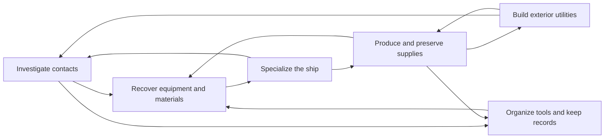

# Open survival — prioritized slice plans

Date: 2026-10-09. The operator approved all six activity directions and asked
for plans, then implementation of the first slice. Replenishment and full-state
persistence preparation run in parallel. No mandatory campaign is introduced.

1. [Useful salvage](01-useful-salvage.md) — first implementation.
2. [Ship specialization](02-ship-specialization.md).
3. [Investigation](03-investigation.md).
4. [Sustainable survival](04-sustainable-survival.md).
5. [Exterior projects](05-exterior-projects.md).
6. [Personal ownership](06-personal-ownership.md).

## How the slices interact

**Shared obligations:** conserved inventory, durable equipment/object identity,
saved depletion and production, physical transport, circuit/heat/cargo costs,
manual service procedures and clear inspection feedback. One simulator owns each
quantity; derived UI/geometry never becomes a second inventory. Existing
approved full refunds for built machines/pods remain; salvaged equipment must
return the same instance, not manufacture a full-cost materials refund.

Replenishment and persistence are cross-cutting workstreams, not chores deferred
until the end. Their preparation is in `replenishment_plan.md` and
`persistence_plan.md`; author concrete edits only with disjoint file ownership.

## First salvaged technology options

| Option | Benefit | Implementation consequence |
| --- | --- | --- |
| Auxiliary battery cabinet (recommended) | More stored energy; no generation | Existing machine and power capacity hook; clear repair/refit reward |
| Ice/water processor | Turn gathered ice into potable reserves | Requires new transfer/output connection and operating costs |
| Survey instrument | Better information before committing to a contact | Requires persisted readings and useful uncertainty |
| Workshop unit | Faster fabrication/repair capability | Existing bench effect; reward is less immediately visible |

The question is pending with the operator. Common salvage identity/procedure,
transport and persistence work can proceed before the choice; do not invent
special technology lore or assume new balance requirements are approved.

## Execution boundaries

Implement one compact wreck and one recovered equipment class first. It must
work through the normal contacts/EVA/cargo/socket loop, with a choice to fit or
scrap. Follow-on slices remain planned; each needs a bounded implementation and
validation record. No broad crafting/save framework, freeform hull rewrite,
co-op or planetary landing is implied by these plans.
